# Q2 Report: Multi-Task Learning (Segmentation + Depth)

## Required WandB Links
- **Vanilla Multi-Task U-Net:** https://wandb.ai/iiith-ameykaran/multitask-unet/runs/aodoyqca
- **U-Net without Skip Connections:** https://wandb.ai/iiith-ameykaran/multitask-unet/runs/701gfx5p
- **U-Net with Residual Blocks:** https://wandb.ai/iiith-ameykaran/multitask-unet/runs/hjhewanr
- **Report** https://wandb.ai/iiith-ameykaran/multitask-unet/reports/Untitled-Report--VmlldzoxNjQzNzE3MQ?accessToken=m0ofuldqkv31mhskyenv7aorgoez58viy0qdqjimtkk2slgceut8cvlq2i6gtxpr
---

## Folder Map
```
vanilla_unet/
  losses.png
  mIOU_plot.png
  RMSE_plot.png
  qualitative_results.png

without_skip/
  losses.png
  mIOU_plot.png
  RMSE_plot.png
  qualitative_results.png

residual/
  losses.png
  mIOU_plot.png
  RMSE_plot.png
  qualitative_results.png

comparisons/
  comparison_miou.png
  comparison_rmse.png
  comparison_val_loss.png
  comparison_plots_if_any.png
  comparison_results_if_any.png
```

---

## What Each Image Represents

### `losses.png`
Three-panel figure showing:
1. **Total combined loss** (train and val) — uses the uncertainty-weighted multi-task loss objective (see §2.1 formula). Loss goes negative as the learned log-variance terms dominate.
2. **Validation segmentation loss** (cross-entropy / Dice component).
3. **Validation depth loss** (L1/MSE component).

### `mIOU_plot.png`
Train and validation mean Intersection-over-Union (mIoU) across all semantic classes, plotted per epoch. Higher is better; shows how well the decoder learns to predict segmentation masks over time.

### `RMSE_plot.png`
Train and validation Root Mean Squared Error for the depth prediction head, plotted per epoch. Lower is better; measures absolute depth accuracy in normalised scale.

### `qualitative_results.png`
Side-by-side grid (epoch 49). Each row contains:
`Input image | GT segmentation mask | Predicted mask | GT depth map | Predicted depth map`
Ten example images are shown (WandB logged one panel of 10 rows per epoch).

---

## 2.1 Vanilla Multi-Task U-Net

### Combined Loss (Formula and Coefficients)

The model uses an **uncertainty-weighted multi-task loss** (Kendall et al., 2018):

$$\mathcal{L} = \frac{1}{2\sigma_{\text{seg}}^2}\,\mathcal{L}_{\text{seg}} + \frac{1}{2\sigma_{\text{depth}}^2}\,\mathcal{L}_{\text{depth}} + \log\sigma_{\text{seg}} + \log\sigma_{\text{depth}}$$

where $\sigma_{\text{seg}}$ and $\sigma_{\text{depth}}$ are **learned** task noise parameters
(logged as `log_var_seg` and `log_var_depth` in WandB).

At the final epoch the learned log-variances are:
- `log_var_seg` = **−0.494** → effective weight factor ≈ 1.64
- `log_var_depth` = **−0.470** → effective weight factor ≈ 1.60

The two tasks receive roughly equal weighting, which the model learns automatically without any manual coefficient tuning.

### Why This Combination
- Avoids the need to hand-tune a fixed λ between segmentation and depth losses.
- As depth improves faster than segmentation early in training, the model automatically increases the relative weight on segmentation (and vice versa).
- The log-penalty prevents σ from collapsing to ∞.

### Training Curves

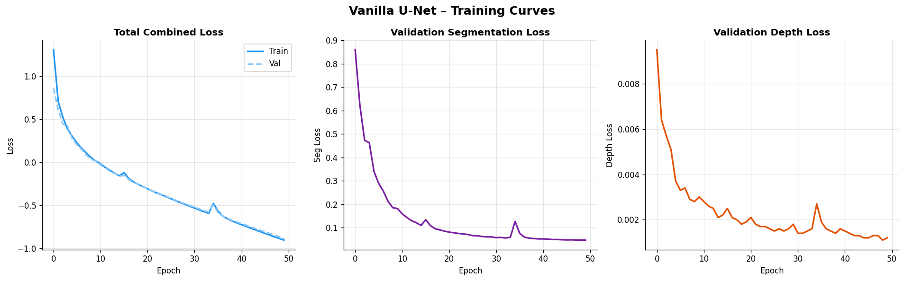
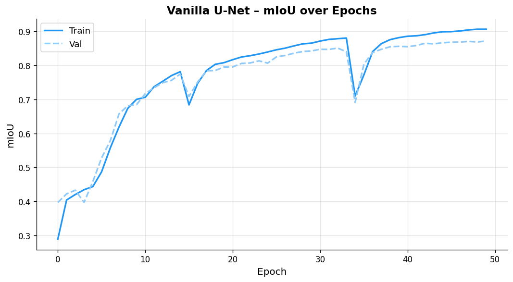
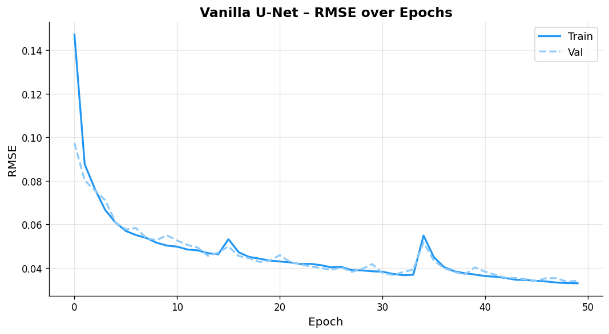

### Final Test Metrics (Epoch 49)
| Metric | Value |
|--------|-------|
| **mIoU** | **0.8714** |
| **RMSE** | **0.03427** |
| **Val Loss** | **−0.8817** |

### Qualitative Results

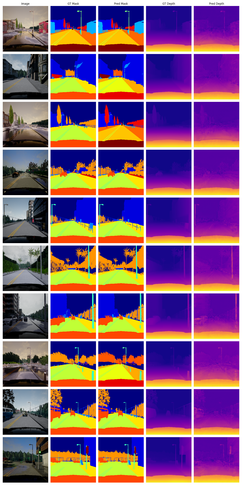

---

## 2.2 U-Net without Skip Connections

In this variant all encoder-to-decoder skip connections are removed. The decoder must reconstruct spatial detail entirely from the bottleneck representation.

### Training Curves

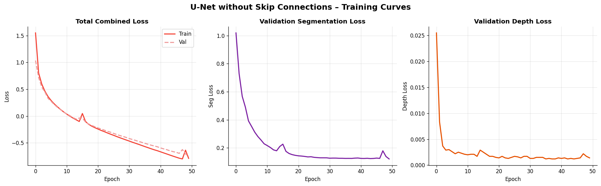
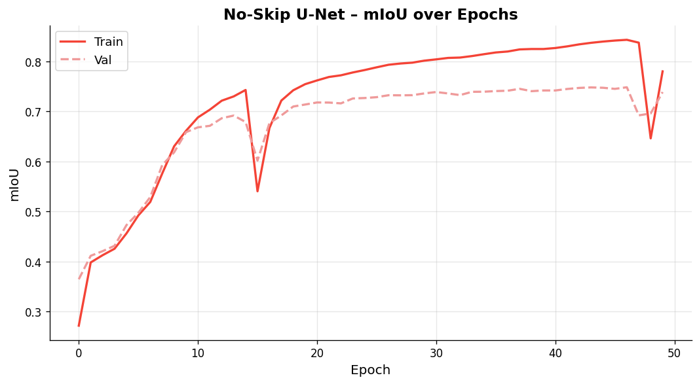
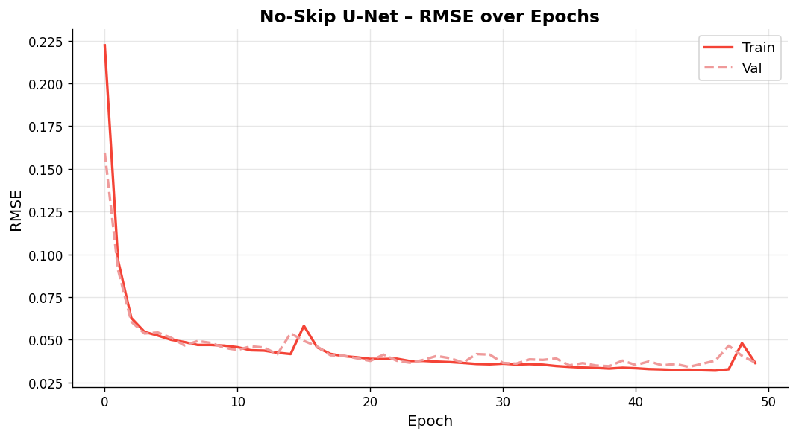

### Final Test Metrics (Epoch 49)
| Metric | Value |
|--------|-------|
| **mIoU** | **0.7386** |
| **RMSE** | **0.03666** |
| **Val Loss** | **−0.7514** |

### Comparison with Vanilla

| Aspect | Observation |
|--------|-------------|
| **Segmentation boundaries** | Noticeably blurrier and less precise. The model cannot leverage fine-grained early-layer features so class boundaries are rounded or missing entirely — a ~13 pp drop in mIoU (0.87 → 0.74). |
| **Depth quality** | Slightly worse overall (RMSE 0.0367 vs 0.0343); coarse depth structure is preserved but fine surface detail (edges of objects) is lost. |
| **Training stability** | More prone to sudden drops (e.g. epoch 47–48 shows a large spike in RMSE and mIoU collapse from 0.84 → 0.65), indicating the bottleneck alone cannot stably represent spatial information without skip paths. |

### Qualitative Results

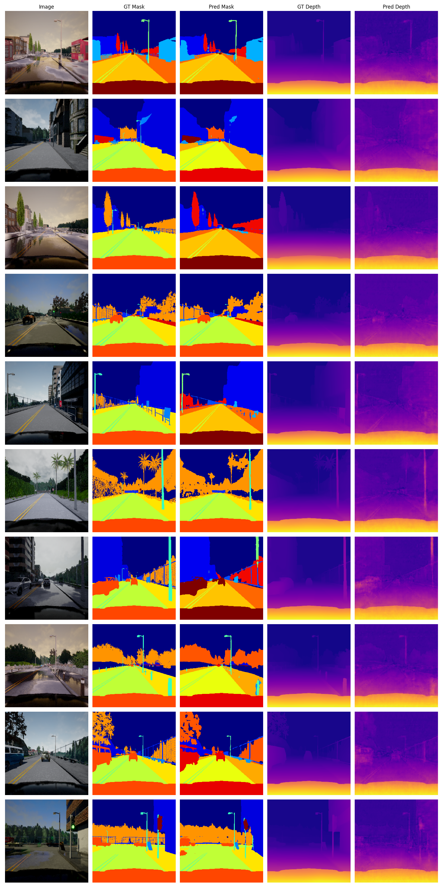

---

## 2.3 U-Net with Residual Connections

Each double-conv block in the encoder and decoder is replaced by a residual block:
```
x → Conv-BN-ReLU → Conv-BN → (+x via 1×1 if needed) → ReLU → out
```
A 1×1 convolution is used for the shortcut when the channel dimension changes. Skip connections are retained as in the vanilla model.

### Residual Block Summary
- **Input**: feature map of shape (C, H, W)
- **Two 3×3 conv** layers with BatchNorm + ReLU
- **Shortcut**: identity if in-channels == out-channels, else 1×1 conv projection
- **Advantage**: deeper gradient flow, reduced feature degradation in deep encoder

### Training Curves

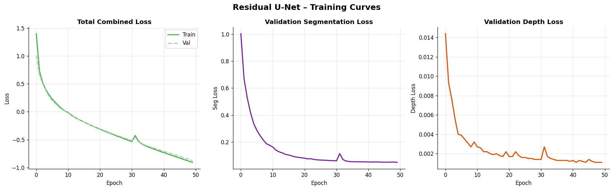
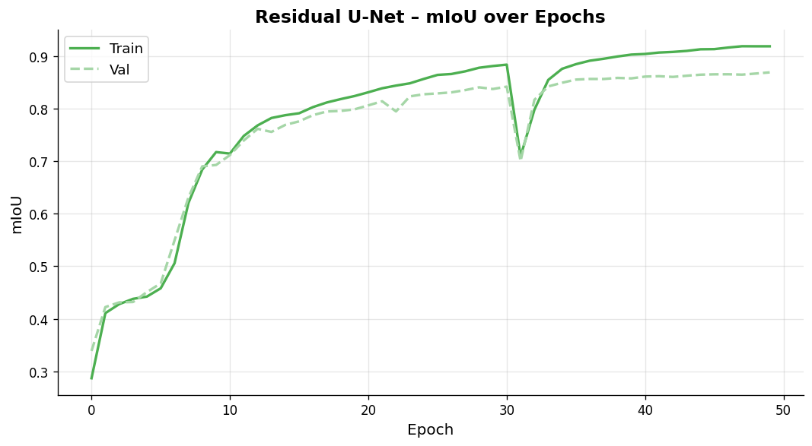
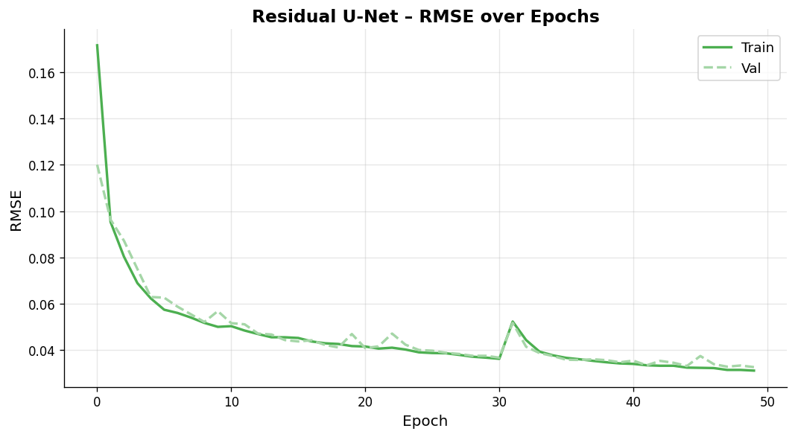

### Final Test Metrics (Epoch 49)
| Metric | Value |
|--------|-------|
| **mIoU** | **0.8686** |
| **RMSE** | **0.03264** |
| **Val Loss** | **−0.8756** |

### Comparison with Vanilla

| Aspect | Observation |
|--------|-------------|
| **Segmentation boundaries** | Comparable to vanilla (mIoU 0.8686 vs 0.8714, ≈0.3 pp lower). Boundary quality is similarly sharp — skip connections combined with residual paths provide rich multi-scale features for the decoder. |
| **Depth quality** | **Better than vanilla** (RMSE 0.0326 vs 0.0343, ~5 % improvement). Residual connections improve gradient flow to the depth head, allowing finer surface normals and depth transitions to be captured. |
| **Training stability** | Smoother convergence overall. Two brief spikes (epoch 31, epoch 34) recover faster than the equivalent in vanilla, likely due to better gradient highways through the residual shortcuts. |

### Qualitative Results

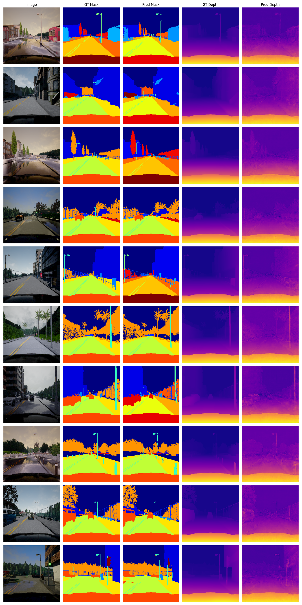

---

## Comparison Table

| Model Variant      | mIoU   | RMSE    | Final Val Loss |
|--------------------|--------|---------|----------------|
| Vanilla UNet       | 0.8714 | 0.03427 | −0.8817        |
| Without Skip UNet  | 0.7386 | 0.03666 | −0.7514        |
| With Residual UNet | 0.8686 | 0.03264 | −0.8756        |

**Key takeaways:**
- Skip connections are **critical** — removing them costs ~13 pp mIoU and degrades depth accuracy.
- Residual blocks marginally hurt segmentation (−0.3 pp mIoU) but improve depth estimation (~5 % better RMSE) compared to vanilla, making them a good trade-off for tasks where depth accuracy is paramount.
- The uncertainty-weighted loss successfully balances both tasks across all architectures.

---

## Comparison Images

### Cross-model Metric Plots

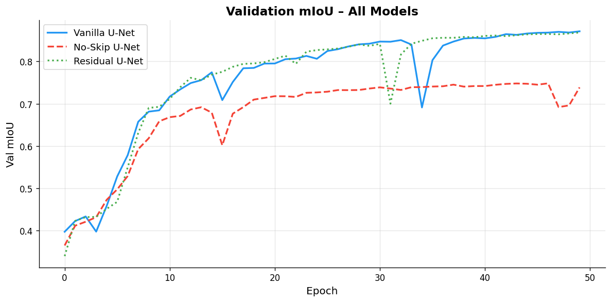
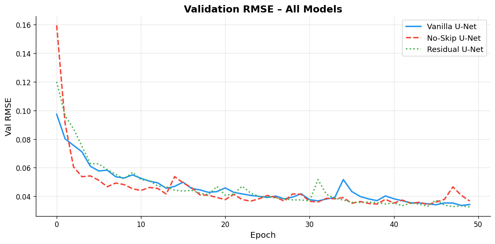
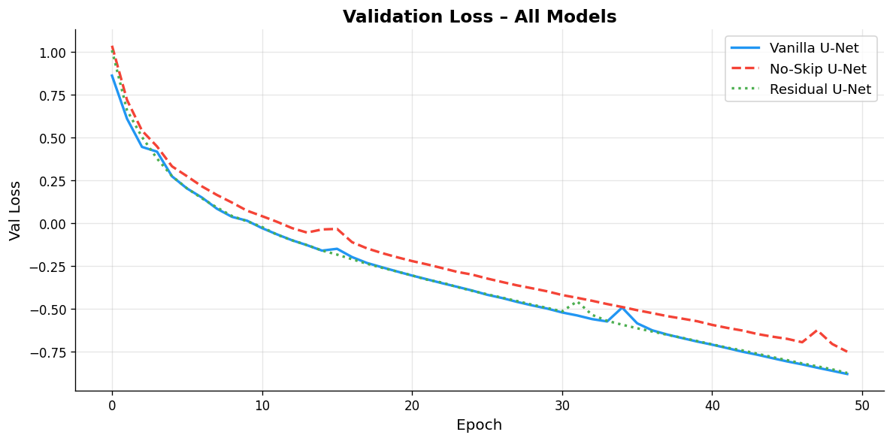
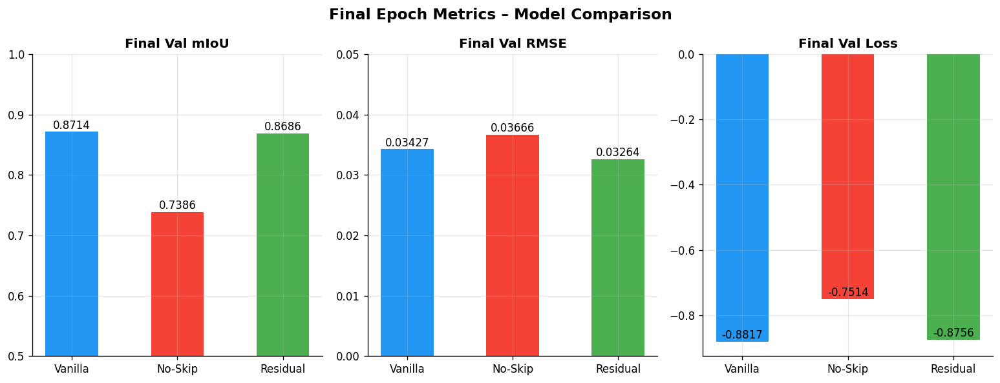

### Cross-model Qualitative Comparison

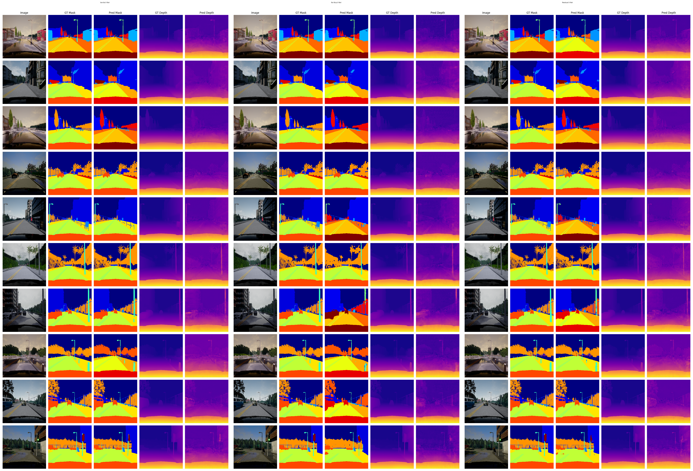

*Left: Vanilla U-Net | Centre: No-Skip U-Net | Right: Residual U-Net*
