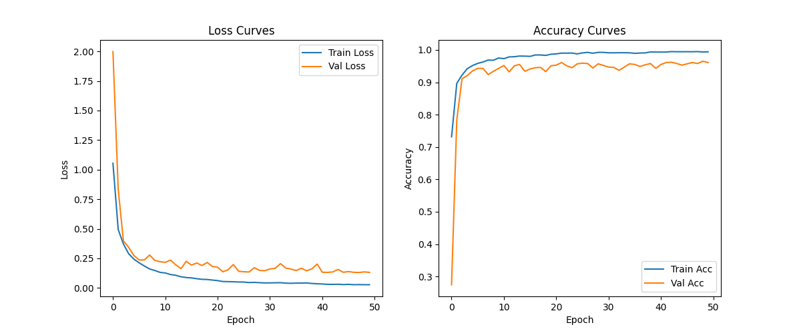
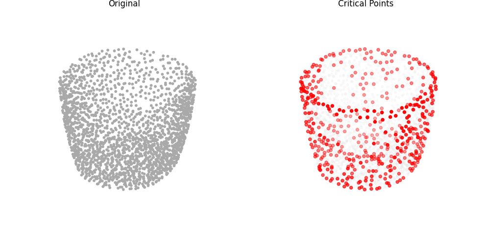
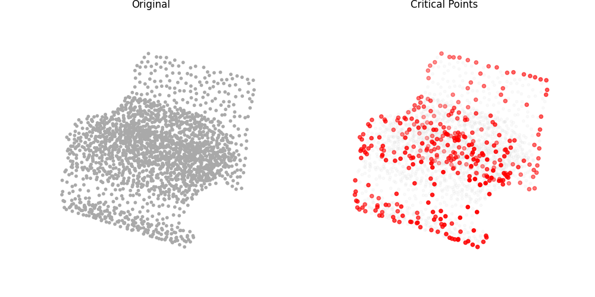
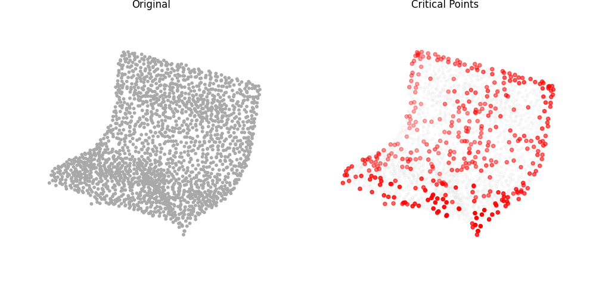
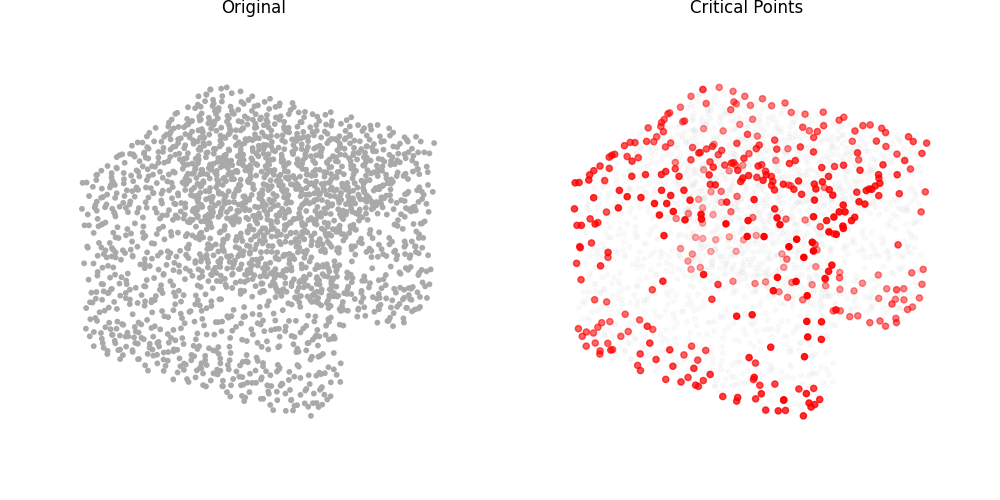
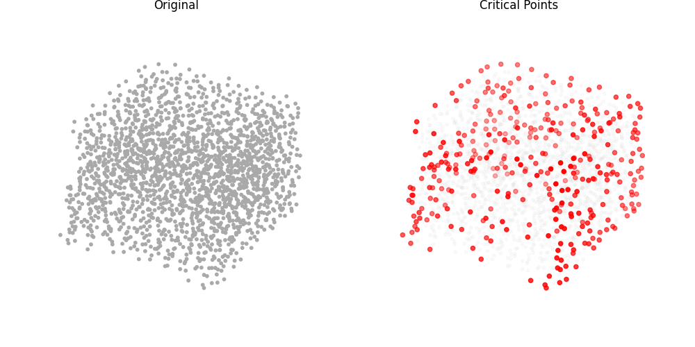
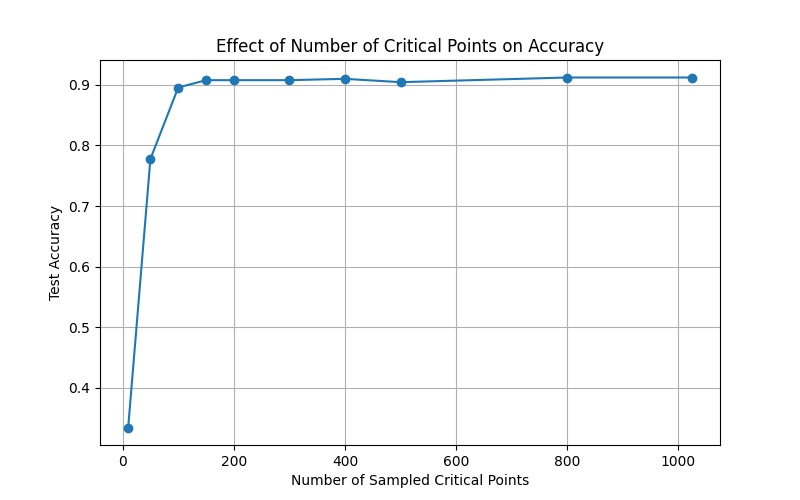

# Q3 Report: Learning on Point Clouds

## 3.1 Losses and Metrics

### Plots
1. Training loss curve
2. Validation loss curve
3. Training accuracy curve
4. Validation accuracy curve

Below are the plots saved together in `losses.png`:

### Final Classification Metrics
- Test loss: 0.2669
- Test accuracy: 0.9042

## 3.2 Permutation Invariance

- Original accuracy: 0.9042
- Permuted accuracy (after random shuffle of input points): 0.9042

Report the percentage of test samples for which the predicted class changes after permutation:
**0.00%** (0 out of all test samples changed their prediction).

Is the result what you expect?
Yes, this is completely expected. PointNet uses a symmetric function (Max Pooling) across the `N` input points to aggregate local features into a global feature vector. Since max pooling is invariant to the order of elements, permuting the input point cloud does not change the resulting global feature vector in any way, resulting in the exact same output logits and class predictions.

## 3.3 Critical Point Analysis and Robustness

### Visualizations (5 test samples)
The critical point visualizations are saved as images (`critical_points_0.png` through `critical_points_4.png`). For each image, the left plot shows the full point cloud (dark gray) and the right plot shows the critical points highlighted in red over the faint full cloud.

### Robustness Experiment (critical-points-only input)
- Accuracy on original subset: 0.9042
- Accuracy on sparse critical-points-only subset: 0.9042

Does the accuracy drop? Briefly explain why based on the network’s architecture.
No, the accuracy does not drop at all. This is a direct consequence of the PointNet architecture, specifically the global max pooling operation. The critical points are conceptually defined as the points that contribute the maximum values for each feature dimension during the max pooling step. Consequently, the global feature vector is constructed entirely from these critical points. If we feed only the critical points back into the network, the max pooling operation will yield the exact same global feature vector as it did with the full point cloud. Since the global feature vector is identical, the outputs of the fully-connected classification layers and therefore the accuracy remain exactly the same.

## 3.4 Effect of Number of Critical Points on Accuracy

To further understand the relationship between the number of critical points sampled and the model's accuracy, we empirically tested retaining `target_n` points ranging from 10 to 1024 points. If less than `target_n` critical points exist for a sample, they are re-sampled (duplicated), and if there are more, we randomly subset them.

### Observation
As shown in the graph, when `target_n` is very small (e.g., 10 or 50), the accuracy is significantly degraded compared to the baseline test accuracy. This happens because discarding true critical points removes essential information that normally forms the global max-pooled feature vector. However, as `target_n` approaches ~300-400, the accuracy converges back to the original baseline. Our tests show that on average, a point cloud of size 2048 only intrinsically uses around ~410 unique critical points. Once the number of sampled points is large enough to encompass this underlying set of critical points, the prediction remains unaltered and the accuracy saturates at its maximal value.
